# Cooking Guide, a hands-free cooking assistant

A mobile cooking app you can control by voice when you cook. I built this high-fidelity prototype as part of a team project at Technical University of Madrid. The aim of the course was to experience firsthand a User-Centered Design process. My contribution to the group project was focused on user research and testing (10 interviews in total), quantitative analysis, drawing conclusions and direction of merging two prototypes from a first design phase.

The first focus of the project was to find out what people would like to see in an application dedicated to cooking and what their common problems are. Then, we moved on to designing two low-fidelity prototypes, one for touch-based and one for voice-based interaction, and tested them to compare the designs and obtain user feedback. Based on the results, some design choices were revised in order to draw usability conclusions, merge the solutions and to build a high-fidelity prototype. Below is my design of the high-fidelity prototype.

### Overview screens of the high-fidelity prototype
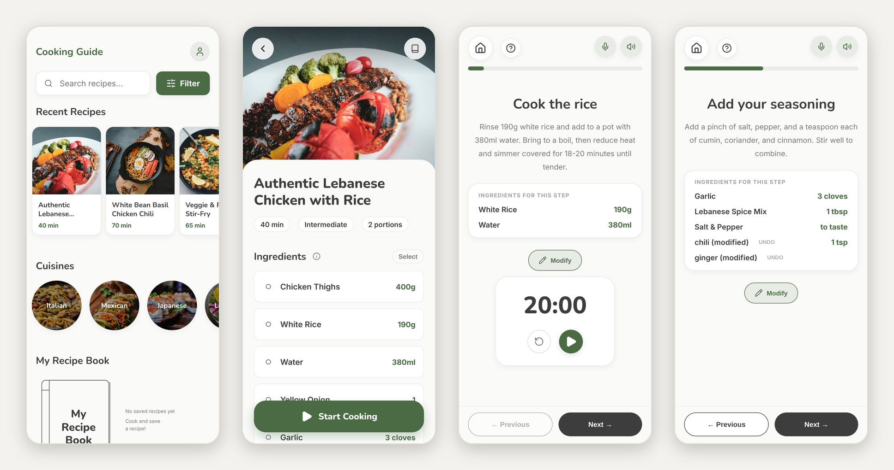

As it is a prototype intended for testing, a lot of the navigation is narrowed down to the specific tasks. The testing sessions focused on the following three:

1. Find a Lebanese recipe with chicken and rice (two portions, preparation time under 60 minutes).
2. Cook the recipe: substitute a missing yellow onion with a red one, find instructions for deboning the chicken, add chili and ginger.
3. Save the recipe as "Lebanese Spicy Chicken", without the ginger ingredient.

(More information on the participant tasks in section 3.2)

## How to run

Link: https://rgluck123.github.io/cooking_guide/

Click the link above which redirects to the prototype. To make the experience similar to standalone application on mobile devices, it is advised to add the website to the Home Screen.

#### Add to Home Screen on iOS
Open the link (preferably in Safari), then tap the share button and 'Add to Home Screen'. If you see the 'Open as Web App' option (iOS 26), keep it on.

#### Add to Home Screen on Android
Open the link (preferably in Chrome), then tap three dots menu and 'Add to Home Screen'.

## Description of the design process

1. Introduction
2. Context of use
3. Low-fidelity prototypes and first usability test
4. High-fidelity prototype
5. Future work ideas
6. Conclusions

---

## 1. Introduction

This repository contains my design of the high-fidelity prototype. The user research and the low-fidelity phase were done together with two fellow students. Below are the main results of each phase and how they influenced further design decisions.

## 2. Context of use

### 2.1 Method

We conducted 8 sessions with 10 participants. Most of the sessions combined an observation in the participant's home (contextual inquiry) with a semi-structured interview of 31 questions. During the observation we followed the whole process of preparing a meal: choosing a recipe, finding the ingredients, cooking and what happens with the recipe afterwards.

Participants were 21 to 30 years old, mostly students and young professionals living in Madrid (70%). Some of the interviews were done online and because of that didn't include observations.

### 2.2 Main findings

- 9 of 10 participants follow the recipe on a smartphone while cooking.
- About 80% of the observed participants looked at the phone again after finishing every step, to see what comes next.
- 30% have trouble using the phone with dirty hands or when the screen locks.
- Videos are popular for learning a new dish, but during cooking 60% of the observed participants preferred short text. Washing hands each time for pausing and rewinding a video is annoying.
- 80% of the observed participants didn't follow the recipe strictly and changed quantities or steps based on intuition. When minor ingredients were missing, they were usually just skipped.
- 70% don't write down the changes they make and rely on memory, so a good change is often forgotten.
- When stuck on a technique like deboning a chicken, 70% look for help online right away (YouTube, Google, ChatGPT).
- 40% find doing several things at once (like two pots and a timer) stressful or chaotic.
- The kitchen is often noisy (music or podcasts for 60%) and shared with roommates.

### 2.3 User needs

From this we wrote down what a cooking app should help with. People need to see the current step at a glance, without scrolling or rewinding a video, and to use the app even when their hands are not clean or busy. They want to change the recipe before and during cooking, and keep these changes for the next time. When a technique is new to them, the help should be available in that step, not somewhere else.

### 2.4 Personas

Based on the results, the tests and the prototypes focused on two personas:

- The creative social cook: uses recipes as a rough guide, experiments with spices, cooks for friends and often forgets the changes made.
- The efficient meal planner: follows new recipes exactly, wants to finish cooking within an hour and finds managing multiple timers stressful.

## 3. Low-fidelity prototypes and first usability test

### 3.1 Competing designs

To compare two different interaction styles, we prepared two low-fidelity prototypes for the same tasks.

| | Design 1: Mobile Cooking Guide | Design 2: Hands-Free Visual Cooking Assistant |
|---|---|---|
| Device | Smartphone | Smart kitchen display with speaker (similar to Amazon Echo Show) |
| Input | Touch only | Voice only |
| Main idea | Cookbook application where the user can edit recipes by tapping during cooking | Assistant guiding the user through the recipe step by step |

### 3.2 Testing phase

The usability test was conducted with 7 participants, using the thinking-aloud method. Every participant tested both designs, in alternating order. In Design 2 one team member acted as the computer, connected through an online meeting and speaking instructions to the participant. I facilitated three of the sessions, prepared the efficiency analysis and the comparison of the designs.

 
 

During the testing sessions, the participants were given the following instructions:

| Task | 1 |
|:---|:---|
| **Title** | Find a recipe |
| **Starting situation** | You are an international student who has just finished a long day at university. You want to cook a nutritious, spice-rich dinner that takes less than an hour to prepare. You have a particular craving for Lebanese cuisine. Since you have a busy week ahead, you want to make enough so that you have leftovers for lunch tomorrow. |
| **Task instructions** | Find a Lebanese recipe for two portions that features chicken and rice, with a total preparation time of less than 60 minutes. Then, open the recipe to view its full details. |

| Task | 2 |
|:---|:---|
| **Title** | Cook and adapt the recipe |
| **Starting situation** | You have all your ingredients ready on the counter, and you are about to start cooking. However, as you begin, you realize you are missing an ingredient: a yellow onion. You also decide that you want to customize the flavour by adding chili and ginger to make the dish spicier. You also have to debone the chicken, but you have never done it before, so you don't know how to do that. |
| **Task instructions** | Now please review the recipe and start the cooking process. Then, follow the steps to finish the recipe, using mainly voice commands since your hands are messy from prepping the food.  Please note the following information: • You don't have any yellow onions, but you do have red ones. • You don't know how to debone your chicken. • Add chili and ginger to the recipe. • You prefer not to touch the smartphone when you are cooking. |

| Task | 3 |
|:---|:---|
| **Title** | Modifications and recipe storing |
| **Starting situation** | The meal was a success. You loved the extra spice, but you've decided that the ginger you added didn't quite fit the Lebanese flavour profile. You want to save this recipe for the future, keeping the new spices but removing the ginger from the list. |
| **Task instructions** | Save the recipe with your modifications, excluding the ginger. Name it 'Lebanese Spicy Chicken' and add it to your Recipe Book. |

### 3.3 Results

| Metric | Design 1 (touch) | Design 2 (voice) |
|---|---|---|
| SUS score | 72.9 | 79.3 |
| Average mistakes (task 2, the longest one) | 6.71 | 0.14 |
| Ratio of actions to optimum (T1 / T2 / T3) | 2.29 / 1.61 / 1.43 | 1.29 / 1.14 / 1.04 |
| Preferred by participants | 4 of 7 | 3 of 7 |

Looking briefly at the metrics, the voice cooking assistant performs much better. However, during the testing we noticed that the researcher who acted as a computer by speaking the commands and instructions made the interaction too effortless. That is why the average mistakes number is near 0. Every inquiry or doubt from the users was resolved quickly because we understood exactly what they meant, which a real speech recognition system would not do. This significant test limitation was taken into account when interpreting the results. Looking back, I would write a scenario with potential user questions or doubts and model answers, and the ‘computer’ researcher would follow it strictly.

### 3.4 Main usability problems

#### Design 1 (touch):

- Ingredients could be edited only after entering a special "Edit" mode. Participants expected to tap the ingredient directly. This caused the most mistakes of all.
- The "Modify" button for adding spices was in the top right corner and was often missed. Participants expected to add ingredients in the ingredient list.
- A small ✓ icon had to be tapped to start the timer and continue, which generated unnecessary friction.
- Recipe cards did not show enough information to choose the right recipe.

#### Design 2 (voice):

- No possibility to see the whole recipe before starting to cook, the visual interface was very minimalistic.
- No clear confirmation after modifying ingredients by voice.
- Some participants did not feel comfortable speaking out loud in the kitchen.
- No spoken guidance for complex steps such as 'deboning'.

### 3.5 Conclusion of the first test

The preferred design depends on the phase of the task. For finding and preparing a recipe, participants liked the visual touch interface where they can browse and see the whole recipe before making a decision. During cooking, touch interaction was viewed as problematic when the hands were occupied. In that case the voice guidance was more efficient. After evaluating the user feedback, the whole testing phase and technical capabilities, the conclusion was to design the high-fidelity prototype as a merged version: a touch-based mobile app for discovery and preparation, and a 'Live Cooking Mode' with voice input and voice output, where touch is also available.

## 4. High-fidelity prototype

### 4.1 Screens

The navigation map shows how the screens connect. Lines without arrows mean the user can go back and forth between the screens, arrows mean the user can only move forward. The red part is the Live Cooking Mode.

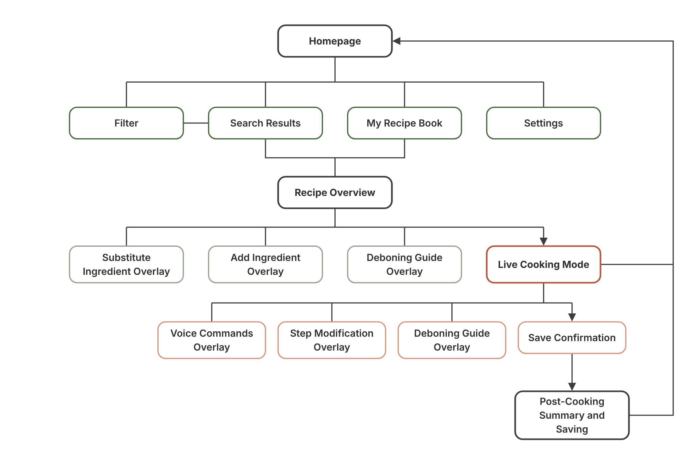

| Screen | Purpose |
|:---|:---|
| Homepage | Search, filter, recent recipes, cuisines, access to My Recipe Book |
| Filter | Filtering by difficulty, protein, portions and time |
| Search Results | Recipe cards matching the search or cuisine |
| Recipe Overview | Ingredients, steps, substitution and adding of ingredients, start of cooking |
| Live Cooking Mode | One step per screen with voice output, voice commands, timer, modifications and additional instructions |
| Post-Cooking Summary and Saving | Review of all modifications, renaming and notes after cooking |
| My Recipe Book | Saved versions of recipes |
| Settings | Default state of voice output and microphone |

### 4.2 Design decisions

#### Finding a recipe

| Screen | Decision | Reason |
|:---:|:---|:---|
|  | Filter button with a text label, right next to the search bar. | In the lo-fi test the filter icon was overlooked and participants tapped the recipe cards instead. |
| 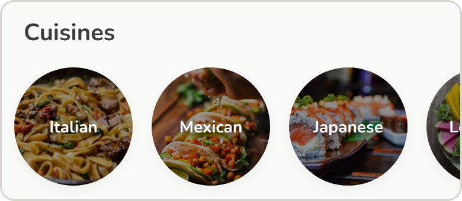 | Cuisines and recent recipes as photo tiles. | People choose a new dish mostly because of how it looks (social media was the trigger for 80% of participants). |

#### Recipe overview

| Screen | Decision | Reason |
|:---:|:---|:---|
| 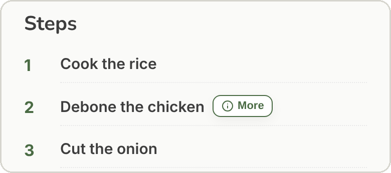 | All ingredients and steps are visible before cooking. The complex step that people might get stuck with has extra help labelled "More". | Not seeing the recipe before cooking was a major problem of the voice-only design. Participants wanted to check first if they would be able to do the steps. |
| 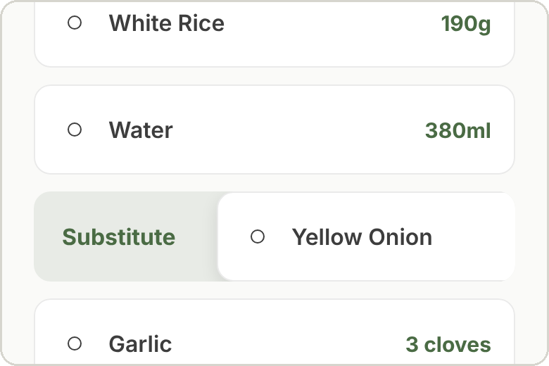 | Swipe right on an ingredient to substitute it, left to remove it, long press for more options. Similar to swiping a song in Spotify. | It replaces the "Edit" mode, the most serious problem of the touch design. The action happens directly on the ingredient and the list stays clean, without extra buttons. |
| 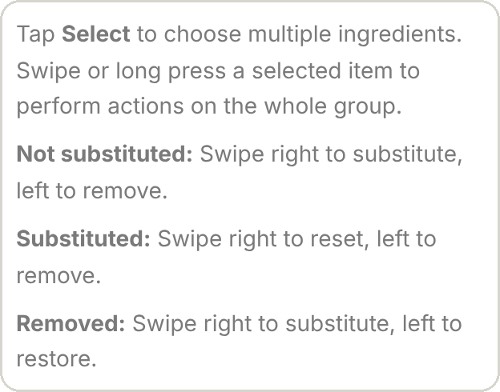 | Info icon next to "Ingredients" that explains the gestures. | Provide more cues about the interaction since users don't know the features of a new application. However, in some informal tests people still needed more hints, so the next version should include a more visible cue or perhaps a small tutorial. |
| 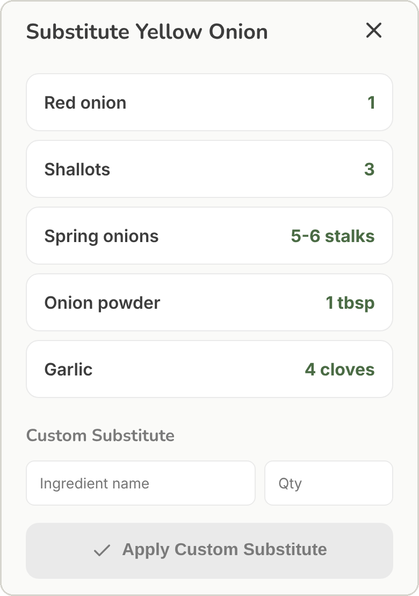 | Suggested substitutes and an option for a custom one. | Most participants improvise with what they have at home instead of going to the shop for one or two ingredients. |
| 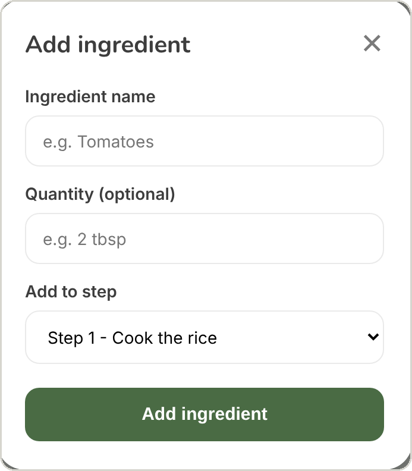 | When adding an ingredient, the user chooses the step it belongs to. | In the lo-fi test participants wanted to add ingredients from the place of the 'ingredient list'. With the step assigned, the new ingredient shows up also in that step during cooking. |

#### Live Cooking Mode

| Screen | Decision | Reason |
|:---:|:---|:---|
| 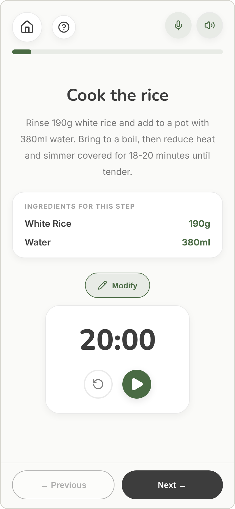 | One step per screen: large title, short instruction, progress bar and big Previous / Next buttons at the bottom. Swiping also changes the step. | People check the phone after every step, so it is better to focus on one step at a time. In addition, it limits unnecessary visual information, which may be distracting if users quickly look at the screens. |
| 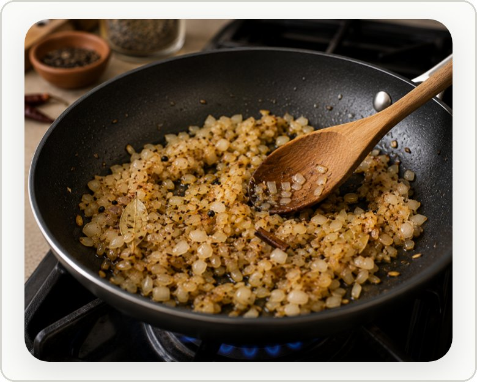 | Photo of how the food should look in a particular step. | Participants wanted to see if the texture and colour are right during cooking, not only on the final step of the dish. |
|  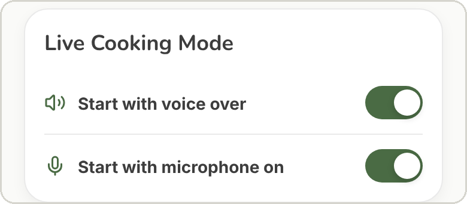 | Read-aloud and microphone are on from the start. Both can be switched off in the 'Live Cooking Mode' header, and their default state is set in Settings. | Primary navigation is hands-free from the first cooking step. If a user didn't want to speak in a shared kitchen, voice can be turned off and everything works by touch as well. |
| 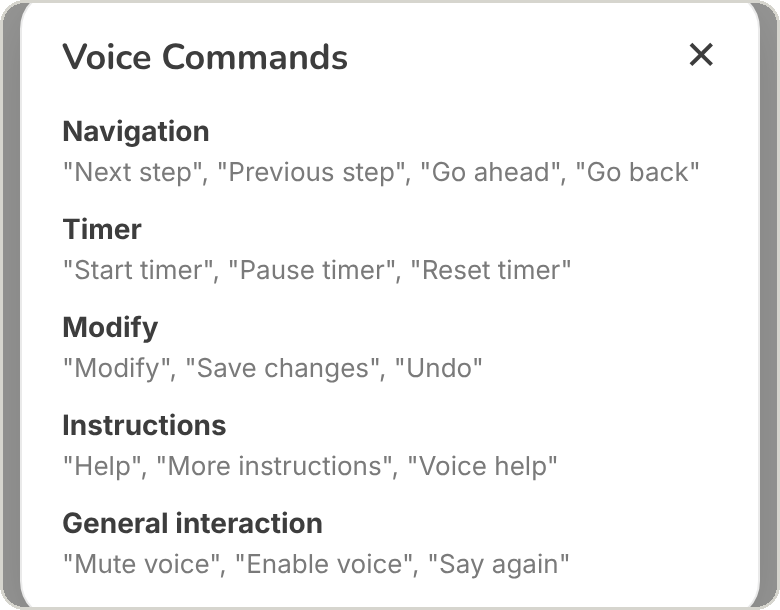 | "?" button with the list of voice commands. | In the lo-fi test a team member acting as a computer understood every phrase. Real speech recognition works best with the predefined commands that users are able to easily check. |
| 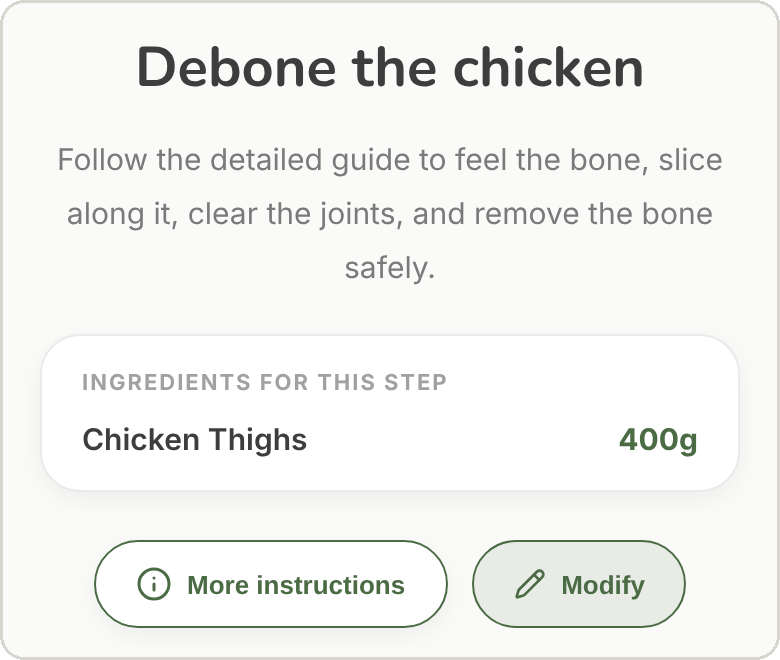 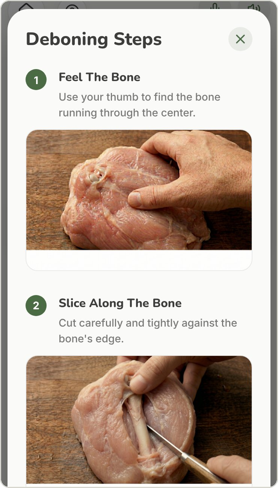 | On the deboning step, "More instructions" (or saying "help") opens a guide with pictures. | Based on the user feedback, it is confusing for users when they don't know how to do a complex step. |

#### Modifications and timer

| Screen | Decision | Reason |
|:---:|:---|:---|
| 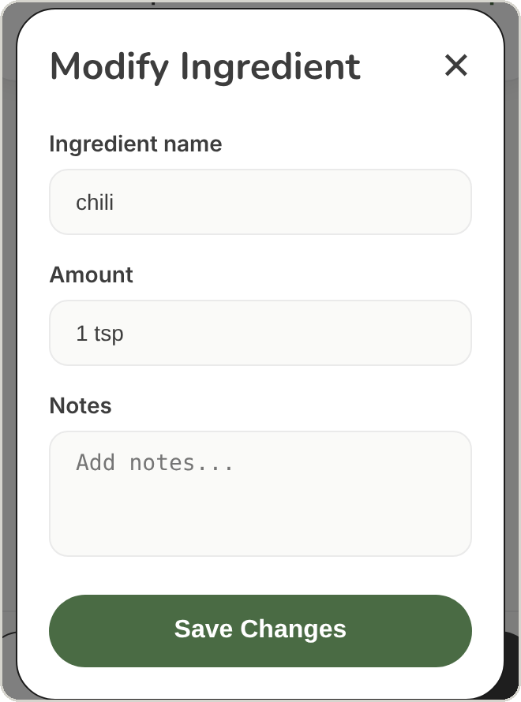 | "Modify" button in the center of each recipe step. It responds to the voice navigation as well. | In the touch lo-fi prototype, the Modify button in the corner was often missed. |
| 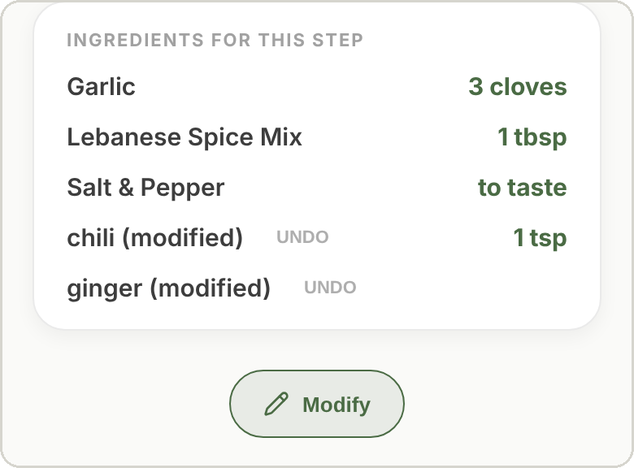 | Added ingredients through the 'Modify Ingredient' dialogue appear in the step right away, with Undo option. | Users should be provided with feedback about the system status and have an undo option where possible. During the first testing participants pointed out the lack of visual feedback after applying modifications in the voice-based prototype.  |
|  | Optional timer with big play/pause and reset buttons, also controlled by voice. | In the touch lo-fi a very small ✓ had to be tapped to set the timer and it was mandatory before going to the next step. That often blocked participants. |

#### Saving the recipe

| Screen | Decision | Reason |
|:---:|:---|:---|
| 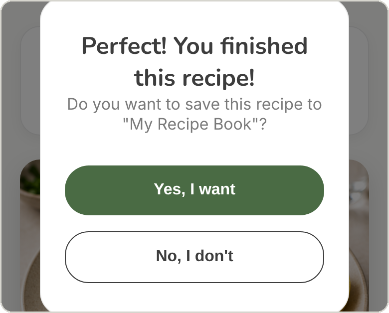 | After the last step the app asks if the user wants to save the recipe. | Some participants closed the recipe after cooking and later couldn't find it again. |
| 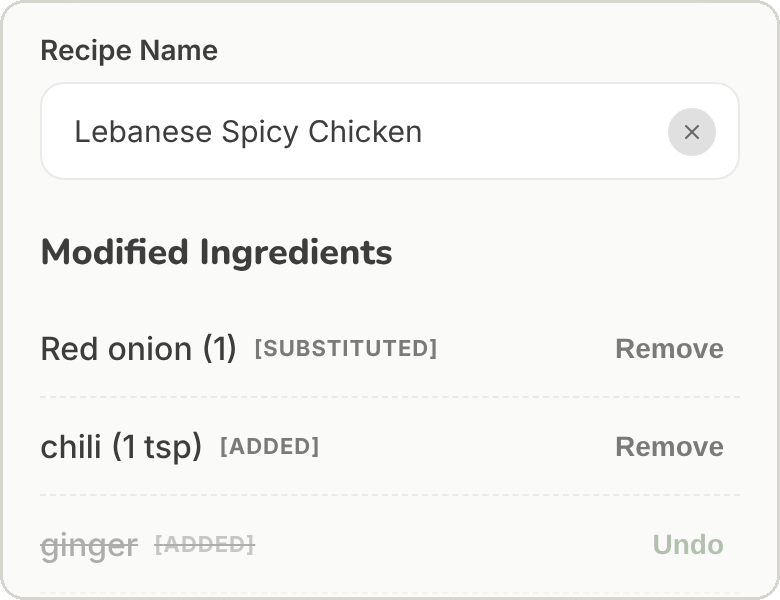 | All modifications are in one list. The user removes the ones that didn't work (in the testing scenario it was the ginger) and renames the recipe. | 70% of participants rely on memory for their changes. Here the app would remember the saved ones. |
| 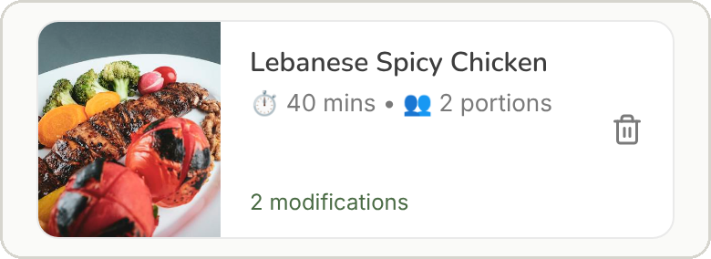 | The recipe is saved as a new version in My Recipe Book, with the chosen name and modifications. | The interaction is consistent within the app. The original recipe is still available unchanged through the same search process. |

### 4.3 Implementation

The prototype is a Progressive Web App built with React and Vite and hosted on GitHub Pages. The coding was primarily done with the help of Gemini 3.1 Pro and GitHub Copilot for students. Especially the voice interaction and the microphone permissions on mobile devices were challenging and required help due to the timeframe of this project. However, the design choices and my conclusions come from the user-centerd design process described above.

Voice input and output use the browser's Web Speech API. The browser turns speech into text, but understanding what the user means in longer/more complicated sentences would need a bigger AI model, which was not in the scope of this project. That is why I focused on the interface navigation, chose a set of keyword commands and included "?" for their reference.

### 4.4 Informal testing

The prototype was tested informally with friends and classmates on my phone and sometimes theirs. Main observations:

- Swipe to substitute was not discovered without the hint.
- Basic voice commands (next, previous, start timer) worked well, longer sentences often were not recognised.
- The behaviour differed between iPhone and Android, for example in microphone permissions and voices.
- Participants asked for additional instructions also in other steps, not only for deboning.

## 5. Future work ideas

Most of the next steps come from the informal tests:

- Voice feedback: show when the app is actually detecting voice instead of just listening and what is understood. In addition, answer unrecognised commands, for example "I didn't catch that, try 'next' or 'help'".
- Learning the commands: a short introduction/tutorial the first time Live Cooking Mode opens, and spoken hints in the relevant steps.
- Gestures indications: a visible cue for swiping, for example a substitute label or a short animation.
- Routing of voice input: understanding longer sentences with an AI model, while keeping the keyword commands for fast actions. Unrecognised commands could also be processed through an AI model to sometimes provide hints for the user.
- Recipe instructions and offer: complete visual help also in other steps, not only for deboning. Add more recipes to be used.

Other improvements I would add:

- Timers that keep running when the user moves to another step, with a sound and vibration at the end.
- Keeping the screen on during Live Cooking Mode.
- UI improvements for better clarity and structure in the Filter, Search Results and Live Cooking Mode screens.
- If speech recognition is not available (for example a permission error), the app should clearly tell the user why the microphone does not work and rely on just reading instructions aloud.
- After saving, navigation to My Recipe Book instead of Home, so the user immediately sees their saved recipe card.

## 6. Conclusions

The whole project consisted of multiple design iterations and enabled me to see how much each phase influences the next. I had the chance to learn and experience the flexibility and thoughtfulness needed for the user-centered design process, for example when adjusting the prototype features and coming up with the idea of combining two interaction types. I enjoyed doing the user research and interviews in person as well and it was very valuable to learn how to conduct them in real time. I liked the process of interpreting the results as it was very influential for the further design. Following just the numbers would have led to choosing only a voice solution without considering the technical side of the prototype.

The high-fidelity prototype is a result of this process and coding it was a complex and rewarding part, mainly because the integration of voice interaction was very ambitious. I encountered several bottlenecks when trying to implement it but on the other hand it also showed me the capabilities of this technology which in my opinion is part of the future, even from an accessibility standpoint. I was very satisfied when the voice navigation worked on multiple iOS and Android devices.

## Comments

Participant data was anonymised and treated according to the Data Protection Plan, signed by participants with Informed Consent.

Food photos are from Unsplash.

Voice interaction requires a browser supporting the Web Speech API (Chrome on Android or desktop, Safari on iPhone with Siri/Dictation enabled) and microphone permission. A hidden User Testing Mode (long press below the card in Settings) shortens the recipe for test sessions. It is switched on by default because the app’s main purpose is user testing.
